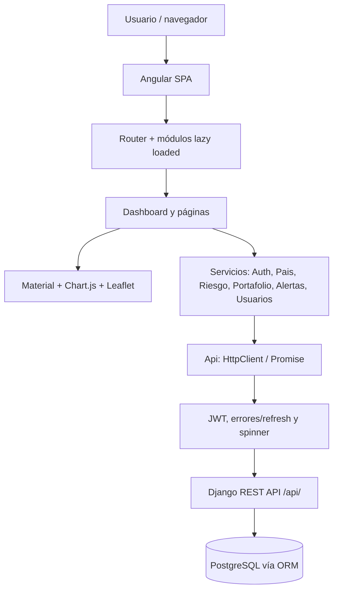

# DataPulse Latam — Frontend

Aplicación **Single Page Application (SPA)** para presentar el índice de riesgo país, indicadores económicos, mapas, portafolios de inversión, alertas y administración de usuarios. Construida con Angular 21.


## 1. Tecnologías utilizadas

| Herramienta | Versión declarada / propósito |
|---|---|
| Angular | 21.2.x (SPA y router) |
| TypeScript | 5.9.x (tipado) |
| Angular Material y CDK | 21.2.x (tablas, formularios, modal, paginación, badges) |
| Chart.js | 4.5.x (gráficas) |
| Leaflet | 1.9.x (mapas interactivos) |
| RxJS | 7.8.x (observables, interceptores y polling) |
| Vitest + Angular unit-test builder | Tests unitarios (`npm test`) |
| npm | `11.6.2` declarado en `packageManager` |


## 2. Arquitectura frontend



### Directorios relevantes

```text
datapulse-frontend/
├── src/
│   ├── app/
│   │   ├── core/
│   │   │   ├── auth/              # AuthService y guards
│   │   │   ├── guards/            # authGuard y adminGuard
│   │   │   ├── interceptors/      # JWT, errores, loading
│   │   │   ├── services/          # Api, alertas, país, portafolio, riesgo, usuarios
│   │   │   └── utils/             # Utilidades de fechas
│   │   ├── modules/
│   │   │   ├── auth/              # Login y registro
│   │   │   ├── dashboard/         # KPIs, mapa, tendencias, ranking
│   │   │   ├── paises/            # Listado, detalle, creación, indicadores
│   │   │   ├── portafolios/       # Listado, detalle, posiciones
│   │   │   ├── alertas/           # Panel y badge de notificaciones
│   │   │   └── usuarios/          # Gestión administrativa
│   │   ├── shared/                # Modales, confirmación, spinner, 404
│   │   ├── app.config.ts          # Router y configuración interceptores
│   │   └── app.routes.ts          # Rutas principales
│   ├── environments/             # URL API desarrollo/producción
│   ├── main.ts
│   └── styles.css
├── angular.json
├── package.json
└── package-lock.json
```

### Rutas de navegación

| Ruta Angular | Vista o módulo | Acceso |
|---|---|---|
| `/auth/login` | Inicio de sesión | Público |
| `/auth/register` | Crear cuenta | Público |
| `/dashboard` | Resumen general, KPIs | `authGuard` |
| `/dashboard/listar-paises` | Catálogo de países | `authGuard` padre |
| `/dashboard/listar-paises/:codigo_iso` | Detalle del país | `authGuard` padre |
| `/dashboard/listar-portafolios` | Listado de carteras | `authGuard` padre |
| `/dashboard/listar-portafolios/:id` | Detalle de cartera | `authGuard` padre |
| `/dashboard/alertas` | Notificaciones | `authGuard` padre |
| `/dashboard/usuarios` | Usuarios | `authGuard` y `adminGuard` |
| `**` | Página no encontrada | — |

## 3. Instalación y ejecución local

### Requisitos

- Node.js compatible con Angular 21; se recomienda una versión LTS soportada, por ejemplo Node.js **22.12+ o 24.x**.
- npm compatible (el proyecto declara `npm@11.6.2`).
- Backend DataPulse levantado previamente en `http://localhost:8000`.
- Acceso a Internet para la instalación inicial de dependencias.

### Paso 1 — Instalar dependencias

```bash
cd datapulse-frontend
npm ci
```

`npm ci` instala usando `package-lock.json` y favorece la reproducibilidad. Si modificas el árbol de dependencias, utilizar `npm install` y actualizar el lockfile con un commit específico.

### Paso 2 — Verificar la URL de la API

`src/environments/environment.development.ts` contiene:

```typescript
export const environment = {
  production: false,
  apiUrl: 'http://localhost:8000/api'
};
```

El archivo `angular.json` reemplaza automáticamente `environment.ts` por `environment.development.ts` en la configuración `development`. `environment.ts` corresponde al build de producción y actualmente contiene la URL de ejemplo `http://dominioproduccion.com/api`: **debe sustituirse por el backend público real antes de desplegar**.

### Paso 3 — Iniciar el frontend

```bash
npm run start
# alternativa equivalente:
# npx ng serve --open
```

Visitar `http://localhost:4200/`, que redirige a `/dashboard` y, en ausencia de login, debería conducir al formulario `/auth/login` mediante el guard.

### Paso 4 — Acceder

Registra un usuario desde `/auth/register` o utiliza una cuenta creada por el administrador en backend. Para funciones administrativas, emplear usuario con rol `ADMIN` y permisos reales en la API. 

## 4. Funcionalidades por módulo

| Módulo | Funciones presentes en código |
|---|---|
| Autenticación | Login, registro, cierre de sesión, almacenamiento de JWT, refresh ante HTTP 401 |
| Dashboard | Resumen con indicadores/KPIs, visualización geográfica de riesgos, series y ranking |
| Países | Listado paginado, detalle, consulta externa, indicadores, histórico cambiario/riesgo |
| Portafolios | CRUD de portafolios, posiciones, distribución de inversión y exportación PDF |
| Alertas | Panel paginado, marcado individual o masivo como leídas, badge de conteo, polling cada 30 s |
| Usuarios | Gestión administrativa de cuentas y roles |
| Compartidos | Modales, confirmación, spinner de carga y pantalla 404 |


## 5. Autenticación, roles y seguridad

1. El formulario llama `POST /api/auth/login/`.
2. `AuthService` guarda `access` bajo `localStorage['token']` y el refresh bajo `localStorage['refresh_token']`.
3. El interceptor JWT añade `Authorization: Bearer <access>` a las solicitudes dirigidas a `environment.apiUrl`.
4. Ante error HTTP 401, el interceptor de errores intenta renovar `access` usando `POST /api/auth/refresh/` y reintenta la solicitud; si falla, ejecuta `logout()` y dirige al login.
5. `AuthService.isAuthenticated()` decodifica el JWT y valida `exp`; `isAdmin()` evalúa rol y condición `is_superuser`.
6. `adminGuard` protege el acceso visual a la administración; el backend realiza la autorización efectiva.

**Limitación detectada:** `src/app/core/guards/auth-guard.ts` actualmente permite paso si hay cualquier cadena `token` en `localStorage`, sin comprobar su expiración. Debe alinearse con `AuthService.isAuthenticated()`.


## 6. Alertas y actualización periódica

El servicio `core/services/alertas.ts` contiene un estado reactivo `unreadCount = signal(0)` y un polling RxJS con `timer(0, 30000)`.

- Se suscribe a `AuthService.currentUser$` para iniciar/detener polling con cambios de autenticación.
- En cada iteración valida `AuthService.isAuthenticated()`.
- Invoca `GET /api/alertas/?page=1&page_size=1&leida=false` para intentar obtener `count` de no leídas.
- Permite `PUT /api/alertas/{id}/leer/` y `PUT /api/alertas/leer-todas/`.


## 7. Comunicación con el backend

`core/services/api.ts` encapsula `HttpClient` y devuelve promesas mediante `firstValueFrom()`. La mayoría de peticiones se envían a `${environment.apiUrl}/${endpoint}`; `getBlob` se usa para exportar PDF.

| Servicio frontend | API usada |
|---|---|
| AuthService | `/api/auth/login/`, `/api/auth/refresh/` |
| Pais | `/api/paises/`, `/api/paises/consultar-externo/`, `/api/paises/{codigo_iso}/...` |
| Riesgo | `/api/dashboard/mapa/`, `/api/dashboard/resumen/`, `/api/riesgo/...` |
| Portafolio | `/api/portafolios/`, posiciones, resumen, PDF |
| AlertasService | `/api/alertas/`, acciones `/leer/`, `/leer-todas/` |
| Users | `/api/auth/usuarios/` |

El sistema utiliza una interfaz HTTP REST, no GraphQL ni WebSockets. El polling de alertas sustituye las notificaciones push en tiempo real.

## 8. Ejecución de pruebas y compilación

```bash

# Compilar la versión productiva
npm run build

# Ver dependencias instaladas
npm ls --depth=0
```

Existen numerosos archivos `*.spec.ts`, pero gran parte corresponde a pruebas de creación básica de componentes/servicios. La presencia de tests **no certifica cobertura suficiente**; comprobar ejecución y ampliar casos funcionales para autenticación, guards, errores HTTP, filtros y módulos principales.

Para inspeccionar errores de la SPA, revisar la consola y pestaña Network del navegador. Para respuestas HTTP 401/403/404/500, comprobar la respuesta de la API y logs del backend. El interceptor `loadingInterceptor` gestiona el spinner durante las peticiones.

## 9. Manejo de errores

- `errorInterceptor` capta respuestas HTTP y administra el reintento con refresh ante 401.
- `loadingInterceptor` muestra y oculta un indicador de carga mediante `finalize`.
- `Alerta` (servicio de mensajes visuales) presenta avisos temporales de éxito, advertencia o error.
- El panel de alertas usa `try/catch` para informar fallos de carga y escritura.
- Al fallar el refresh, se cierra la sesión local y se redirige a `/auth/login`.

Actualmente los errores no se envían a una plataforma central de observabilidad desde el código inspeccionado. No debe declararse Sentry ni logging remoto como implementados.

## 10. Build y despliegue

```bash
npm run build
```

El directorio de salida se determina por el builder Angular en `angular.json` (comúnmente `dist/frontend-app/browser/` para builds de aplicación). Confirmar la ruta real tras compilar. Configurar el hosting estático con fallback SPA a `index.html` al recargar subrutas.

Antes del despliegue:

1. Sustituir la URL ficticia de `src/environments/environment.ts` por la del backend HTTPS real.
2. Confirmar que Django permita el origen CORS real del frontend.
3. Configurar el servidor/hosting para devolver `index.html` en rutas SPA.
4. Ejecutar `npm test` y `npm run build` y verificar el resultado.
5. Probar login, refresh, roles, API y alertas contra el backend de ese ambiente.

| Dato solicitado por la prueba | Valor |
|---|---|
| Frontend local | `http://localhost:4200/` |
| API local | `http://localhost:8000/api/` |
| Frontend desplegado | **Pendiente a uso personal** |
| API desplegada | **Pendiente a uso personal** |
| Credenciales de evaluación | **** |

## 11. Decisiones técnicas

- **Angular 21:** componentes, módulos, rutas lazy-loaded, formularios y ecosistema TypeScript; alternativa: React o Vue.
- **Angular Material:** elementos de UI reutilizables con menor costo de implementación; alternativa: Bootstrap o diseño propio.
- **Chart.js y Leaflet:** bibliotecas dedicadas a visualizaciones cuantitativas y geográficas; alternativas: ECharts y MapLibre.
- **RxJS:** interceptores y polling sin bucles manuales; alternativa: `setInterval` con manejo explícito de concurrencia, menos apropiada en Angular.
- **Servicios HTTP compartidos:** separan presentación, transporte y parte del estado; alternativa: llamadas directas desde componentes (menor cohesión).


## 12. Repositorio del backend
